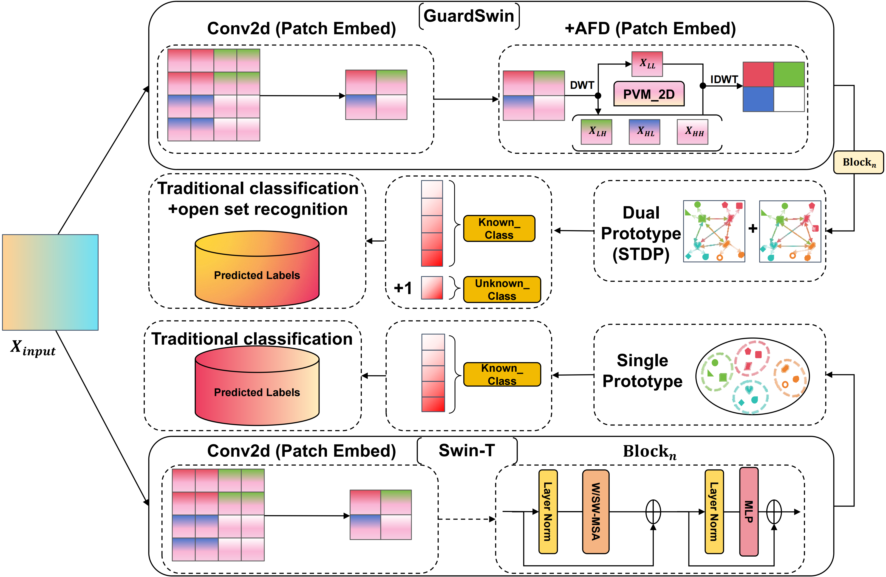
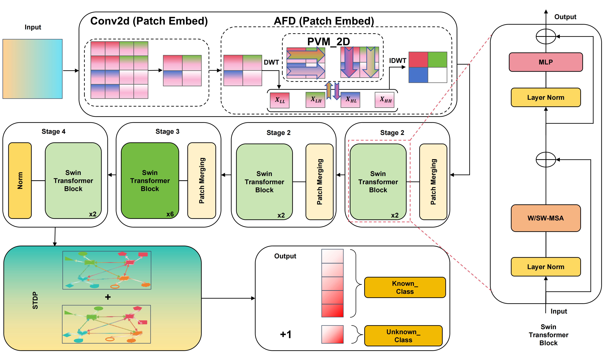

# GuardSwin: Calibrated Learning with Dual Prototypes for Safe Medical Image Classification
<!-- 封面/Logo预留位 -->
<div align="center">
  
</div>

---
## News
- **[2025-12-31]** Initial release of the code and paper submission. (Note: The core model source code file will be released shortly after the paper is accepted.)
## Introduction
**GuardSwin: Calibrated Learning with Dual Prototypes for Safe Medical Image Classification**   
<!-- 架构图预留位 -->
<div align="center">
  
  <br>
  <em>Figure 1: The overall architecture of the GuardSwin framework.</em>
</div>

## Pre trained weights
We provide pre-trained models. You can download them from **Baidu Cloud**.
| Model | Dataset | Params (M) | GFLOPs | Acc / FPR@95TPR | Download |
| :--- | :--- | :---: | :---: | :---: | :---: |
| GuardSwin-T | NCT-CRC-HE (OSR) | 27.56 | 4.39 | 0.9808 (FPR@95TPR) | [Baidu Cloud](https://pan.baidu.com/s/1uAH4n8nvI5lOPDSRGdN5Bg?pwd=idae)/ [log](./fig/Osr_Swin_STDP_AFD.txt)|
| GuardSwin-T | TissueMNIST | 27.56 | 4.39 | 0.0748% (Acc) | [Baidu Cloud](https://pan.baidu.com/s/1IpuAMg51CT37_XSer45TCQ?pwd=7dgz)/ [log](./fig/Swin_TissueMNIST_STDP_AFD.txt)|
| GuardSwin-T | BloodMNIST | 27.56 | 4.39 | 97.37% (Acc) | [Baidu Cloud](https://pan.baidu.com/s/1FhiEIUujxnk0T5TZkilGwg?pwd=f2a9)/ [log](./fig/Swin_BloodMNIST_STDP_AFD.txt)|
| GuardSwin-T | OCTMNIST | 27.56 | 4.39 | 82.00% (Acc) | [Baidu Cloud](https://pan.baidu.com/s/18Ha1Iu-x5BDL2ve41i7Y-Q?pwd=n5pu)/ [log](./fig/Swin_OCTMNIST_STDP_AFD.txt)|

## Main Results

### 1. Open-Set Recognition (NCT-CRC-HE-ODD)
| Method | AUROC ↑ | FPR@95TPR ↓ | Acc_unknown ↑ | Params (M) |
| :--- | :---: | :---: | :---: | :---: |
| Swin-T | 0.9772 | 0.0963 | 90.29% | 27.50 |
| TinyViM-L | 0.9790 | 0.0971 | 91.17% | 31.09 |
| **GuardSwin** | **0.9808** | **0.0748** | **92.47%** | 27.56 |
### 2. Closed-Set Classification (MedMNIST)
| Method | TissueMNIST (Acc) | BloodMNIST (Acc) | OCTMNIST (Acc) |
| :--- | :---: | :---: | :---: |
| Swin-T | 68.90% | 96.99% | 81.40% |
| VMamba-S | 69.31% | 97.05% | **82.10%** |
| **GuardSwin** | **70.08%** | **97.37%** | 82.00% |

## Getting Started
### Installation
1. Clone the repository:
   ```bash
   git clone https://github.com/QvQTT05/GuardSwin.git
   cd GuardSwin
2. Create a conda environment and install dependencies:
   ```bash
   conda create -n Guardswin python=3.11.11
   conda activate Guardswin
   pip install -r requirements.txt
   ## mamba_ssm-2.2.5+cu12torch2.8cxx11abiFALSE-cp311-cp311-linux_x86_64.whl
   ## causal_conv1d-1.5.2+cu12torch2.8cxx11abiFALSE-cp311-cp311-linux_x86_64.whl
### Data Preparation
Download the datasets and structure them as follows:
```
data/
├── datasets/
│   ├── train/
│   ├── val/
│   └── test/
└── ...
```
```
  cd data
  python create_Medmnist.py
  # After manually downloading the NCT-CRC-HE-100K dataset and imagenet1k dataset, run the following steps in sequence
  python create_NCT-CRC-HE-100K_osr.py
  python create_nct_crc_for_imagenet_ood.py
```
### Training
To train GuardSwin on a single GPU. The specific parameters of the model can be manually adjusted in base.yaml
# For Closed-Set Classification
```
  cd TrTsOp
  python train.py
```
# For Open-Set Recognition
```
  cd TrTsOp/osr
  python train_baseline_osr.py
```
### Evaluation
```
  # For Closed-Set Classification
  cd TrTsOp
  python test.py
```
```
  # For Open-Set Recognition
  cd TrTsOp/osr
  python predict_osr.py
```
### Acknowledgement
This project is built upon Swin Transformer. We thank the authors for their great work and open-source contributions.
## Citing Swin Transformer
```
@inproceedings{liu2021Swin,
  title={Swin Transformer: Hierarchical Vision Transformer using Shifted Windows},
  author={Liu, Ze and Lin, Yutong and Cao, Yue and Hu, Han and Wei, Yixuan and Zhang, Zheng and Lin, Stephen and Guo, Baining},
  booktitle={Proceedings of the IEEE/CVF International Conference on Computer Vision (ICCV)},
  year={2021}
}
```